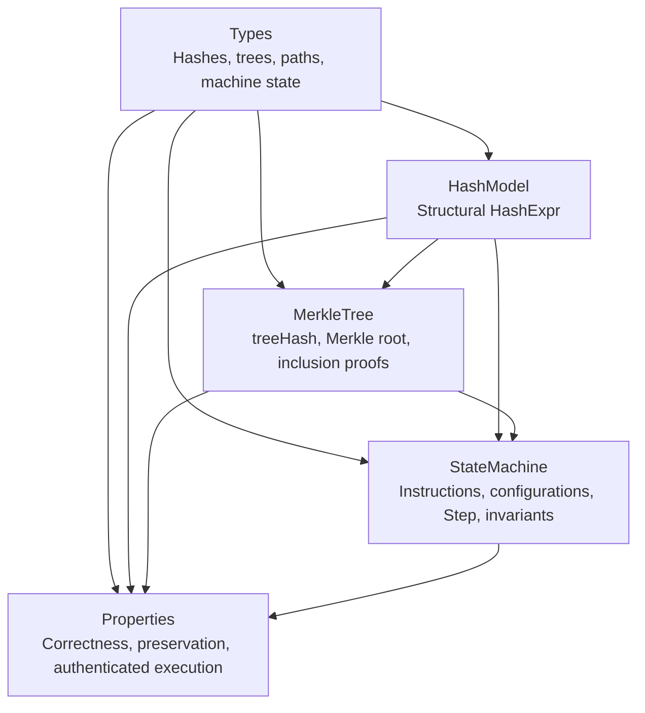

# VeriMerkle-VM

**A zero-postulate, formally verified Merkle-authenticated virtual machine
state architecture built in Cubical Agda.**

VeriMerkle-VM is a constructive formalization of Merkle-tree structure,
authentication-path reconstruction, and a small state-transition system. Its
proofs use Cubical Agda path equality (`_≡_`), and its modules are configured
for checking with Agda's `--safe` option.

> **Scope note:** `HashExpr` is a structural symbolic model, not a
> cryptographic hash function. The proofs establish properties of the
> definitions and witnesses in this codebase; they do not establish collision
> resistance, preimage resistance, or security of a concrete VM or hash
> implementation.

## Architecture

```text
                         ┌─────────────────┐
                         │ VeriMerkle.Types│
                         │ Natural-number  │
                         │ aliases, trees, │
                         │ paths, states   │
                         └────────┬────────┘
                                  │
                    ┌─────────────▼─────────────┐
                    │ VeriMerkle.HashModel      │
                    │ Structural HashExpr       │
                    └─────────────┬─────────────┘
                                  │
                    ┌─────────────▼─────────────┐
                    │ VeriMerkle.MerkleTree     │
                    │ treeHash, paths, verify   │
                    └─────────────┬─────────────┘
                                  │
                    ┌─────────────▼─────────────┐
                    │ VeriMerkle.StateMachine   │
                    │ Configuration, Step,      │
                    │ invariant, progress       │
                    └─────────────┬─────────────┘
                                  │
                    ┌─────────────▼─────────────┐
                    │ VeriMerkle.Properties     │
                    │ Correctness and           │
                    │ authenticated execution   │
                    └───────────────────────────┘
```

The module dependency and proof flow can also be viewed as:



## Modules

| Module | Contents |
| --- | --- |
| `VeriMerkle.Types` | Natural-number aliases for hashes, addresses, and values; binary Merkle trees; directions and paths; machine states and transitions. |
| `VeriMerkle.HashModel` | The inductive symbolic hash-expression type (`HashExpr`). |
| `VeriMerkle.MerkleTree` | Structural tree hashing, Merkle roots, inclusion-proof witnesses, path reconstruction, and equality-based verification. |
| `VeriMerkle.StateMachine` | `read`, `write`, and `increment` instructions; running/stopped configurations; the `Step` relation; state invariant preservation and progress. |
| `VeriMerkle.Properties` | Hash/tree correctness and determinism, inclusion soundness/completeness, preservation, and an authenticated state-transition witness. |

`StateMachine` is the implementation module for the machine in this workspace;
there is currently no separate `VeriMerkle.SmartContract` module.

## Trust and verification

The five Agda source modules enable the same options:

```agda
{-# OPTIONS --cubical --safe --guardedness #-}
```

The project sources contain no declared postulates or axioms, unsafe trust
primitives, termination escape hatches, or unsolved-meta holes. `--safe`
provides an additional compiler-enforced restriction on unsafe declarations in
these modules. These statements concern the project sources; as with any Agda
development, the trustworthiness of imported libraries and the compiler is
part of the verification environment.

The current state transition rules and hash model are intentionally small and
structural. In particular, the `HashExpr` syntax is not an executable or
collision-resistant cryptographic hash, and an equality-based inclusion
witness should not be interpreted as a complete production authentication
protocol.

## Getting started

### Prerequisites

1. Install Agda and make the `agda` executable available on your `PATH`.
2. Install a compatible Cubical library and register it with Agda so that
   `Cubical.Foundations.Prelude` resolves. Follow the installation instructions
   for the versions of Agda and the Cubical library you use.
3. Run commands from the workspace root (the directory containing
   `VeriMerkle\`).

Check the compiler:

```powershell
agda --version
```

### Compile and check

Type-check the final module and its imported dependency graph:

```powershell
agda --cubical --safe --guardedness -i . VeriMerkle\Properties.agda
```

To check each module explicitly, run:

```powershell
agda --cubical --safe --guardedness -i . VeriMerkle\Types.agda
agda --cubical --safe --guardedness -i . VeriMerkle\HashModel.agda
agda --cubical --safe --guardedness -i . VeriMerkle\MerkleTree.agda
agda --cubical --safe --guardedness -i . VeriMerkle\StateMachine.agda
agda --cubical --safe --guardedness -i . VeriMerkle\Properties.agda
```

Agda follows imports and may create `.agdai` interface cache files alongside
the source modules. A successful check exits without type errors. Ensure the
Cubical library is configured if Agda reports that
`Cubical.Foundations.Prelude` cannot be found.

## License

Copyright © 2026 **Shahmeer Khaskheli**.

This project is licensed under the **Apache License, Version 2.0**. You may
obtain a copy of the license at
[https://www.apache.org/licenses/LICENSE-2.0](https://www.apache.org/licenses/LICENSE-2.0).
